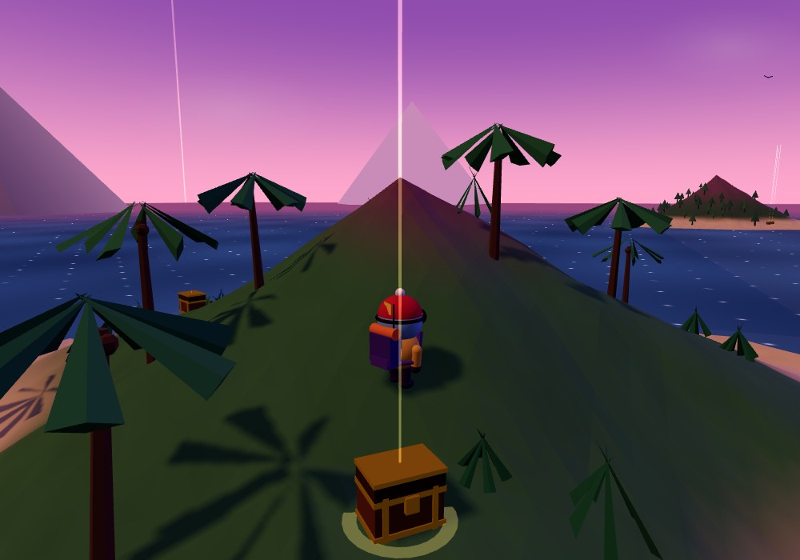

# PICO — protótipo 3D de escalada



Um jogo de escalada em 3D feito em **um único arquivo HTML** com [Three.js](https://threejs.org/),
inspirado em **PEAK** (Aggro Crab & Landfall): uma montanha, um arquipélago cheio de baús,
um barco e uma **stamina** que não deixa você errar.

> Projeto de fã, feito do zero. Não é afiliado nem oficialmente ligado a PEAK.

## Jogar online

**https://guilhermejesus777.github.io/jogoPEAK-teste1/**

## Como jogar

```bash
# qualquer servidor estático serve, por exemplo:
npx serve .
# ou
python -m http.server 8123
```

Depois abra `http://localhost:8123` no navegador.

Também dá para abrir o `index.html` direto — precisa de internet só para carregar o Three.js do CDN.

## Controles

| Tecla | Ação |
| --- | --- |
| `WASD` | andar |
| `SHIFT` | segurar / escalar (perto de uma parede) |
| `ESPAÇO` | pular / saltar da parede |
| `1` | usar energético (+stamina) |
| `2` | usar bandagem (cura lesão) |
| `3` | comer lanche (+fome) |
| `F` | fincar pitão na parede (corda salva quedas) |
| `E` | abrir baú / entrar no barco / desembarcar / usar estátua |
| `M` | ligar/desligar som |
| `MOUSE` | olhar (pointer lock ou arrastando com o botão esquerdo) |
| `Q` | girar a câmera |
| `RODA` | zoom |
| `R` | voltar ao último acampamento |
| `ESC` | pausar |

> Se o mouse não girar a câmera (alguns navegadores/iframes bloqueiam o *pointer lock*),
> **arraste com o botão esquerdo** que funciona igual.

## O que tem no jogo

- **Uma montanha principal** com biomas por altitude: praia, mata, rocha e neve no cume.
- **Arquipélago**: 5 ilhas espalhadas pelo mar (coco, névoa, gelo, perdida e uma ilhota),
  com vegetação, gelo, ruínas e praias próprias.
- **24 baús** espalhados pela ilha principal e pelas ilhas — cada um com feixe de luz dourado.
  Chegue perto e aperte `E` para abrir: energéticos, lanches, bandagens, pitões e, às vezes,
  uma **relíquia antiga** que aumenta a stamina máxima de vez.
- **Barco**: na praia perto do acidente. Aperte `E` para entrar, `W` acelera, `A`/`D` viram e
  `E` desembarca na costa. Sem barco, a água funda te segura.
- **Bússola de baú** no canto da tela apontando para o baú fechado mais próximo, com a distância.
- **Estátua antiga** na ilha perdida: `E` concede +12 de stamina máxima e cura tudo.
- **Local do acidente**: avião quebrado, caixotes e um baú no começo — o ponto de partida.
- **Itens pelo caminho**: **energéticos** (`1`, stamina), **lanches** (`3`, fome) e **bandagens**
  (`2`, curam perna quebrada). Os itens brilham no cenário.
- **Fome**: cai com o tempo, escalando e no frio; com fome a stamina regenera muito devagar.
  Lanches e acampamentos enchem a barriga.
- **Pitões e corda** (`F`): finque um pitão na parede enquanto escala. Se você cair perto dele,
  a corda te segura e você fica pendurado — use `W`/`S` para subir/descer pela corda e `ESPAÇO`
  para soltar. São 6 pitões por escalada.
- **Zonas por altitude** com aviso na tela e **objetivo atual**: praia → mata → rocha → neve → cume.
- **Clima por altitude**: névoa mais fria e fechada, luz azulada, neve em partículas e tempestade
  no topo.
- **Frio**: acima da linha da neve a stamina regenera devagar e drena mais rápido.
  Fogueiras aquecem, curam a lesão e alimentam.
- **Lesão**: queda feia quebra a perna — você anda e escala mais devagar até usar bandagem.
- **Personagem estilo escoteiro do PEAK**: cabeça redonda, óculos, gorro, jaqueta e mochila com
  saco de dormir e bandeirinha. Dá para escolher a cor da jaqueta no menu.
- **Escalada**: segure `SHIFT` numa parede, suba/desça/lateralize pela superfície.
  Quanto mais íngreme, mais devagar (e mais stamina).
- **Stamina**: cai escalando, regenera em platôs — planeje as paradas.
- **Acampamentos**: 3 fogueiras no caminho viram checkpoint, enchem a stamina e curam.
- **Áudio procedural** (WebAudio): vento por altitude, fogueira, passos, escalada, itens,
  pitão, corda e baú. `M` silencia.
- **Tela de vitória** com tempo, altitude, itens usados, quedas, baús abertos e **recorde salvo**.
- **Biomas com props**: palmeiras, samambaias, arbustos, pedras, gelo no topo e placas de trilha.
- Água com ondas, ilhas ao fundo, árvores, nuvens e pássaros.

## Como funciona (por baixo)

- **Terreno procedural:** heightmap analítico (cone + ruído + terraços + praia) para a montanha
  principal e para cada ilha do arquipélago, com malha low-poly e cores por vértice.
- **Física:** colisão por amostragem de altura, limite de degrau (não sobe paredão andando),
  escorregão em encostas íngremes e bloqueio de água funda.
- **Barco:** navegação simples com aceleração, arrasto, curva proporcional à velocidade e
  desembarque automático na costa mais próxima.
- **Escalada:** o jogador gruda na superfície e anda no plano tangente; a âncora é mantida em
  `(x, z)` e a altura vem do heightmap, então a velocidade é corrigida pela inclinação.

## Próximos passos possíveis

- Multijogador real (o coração de PEAK) com WebSocket
- Escalada em dupla com corda conectando dois alpinistas
- Mais eventos aleatórios (tempestade, deslizamento, resgate)
- Mais ilhas, baús raros e um sistema de carga/mochila

## Stack

- Three.js (via CDN, import map)
- HTML/CSS/JS puros — sem build, sem dependências locais
